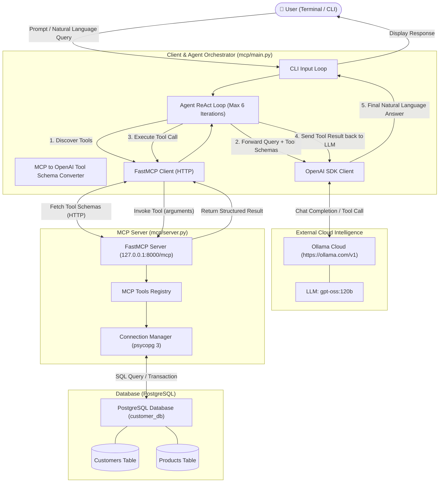
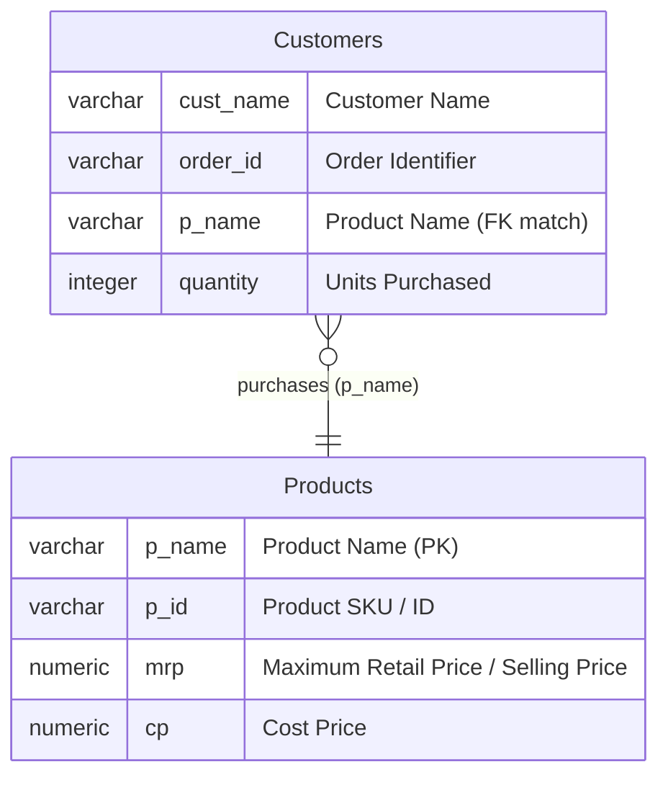
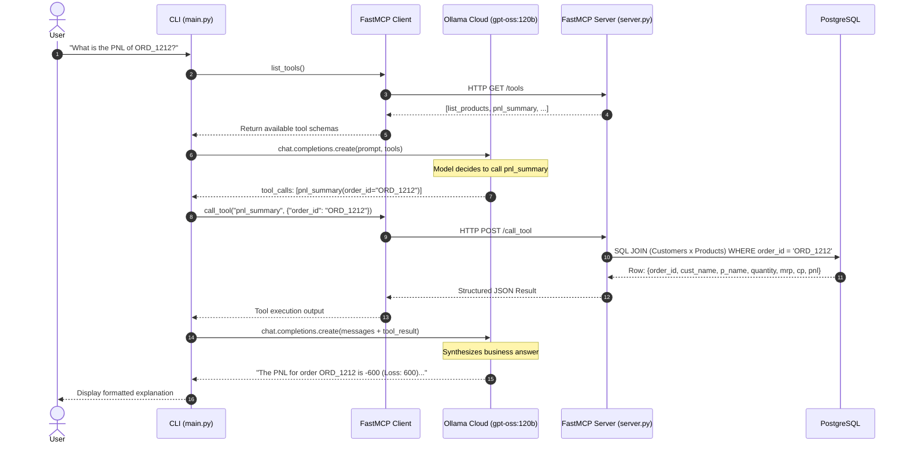

# System Architecture: MCP with Ollama Cloud

This document outlines the end-to-end architecture of the **MCP with Ollama Cloud** application. The system connects an LLM hosted on **Ollama Cloud** to a local **PostgreSQL** database via the **Model Context Protocol (MCP)** using the **FastMCP** framework.

---

## 1. High-Level Architecture Diagram

---

## 2. Core Architectural Components

### 2.1. Client & Agent Orchestrator (`mcp/main.py`)
* **Role**: The consumer interface that drives the ReAct (Reasoning + Acting) loop.
* **Technology**: Python `asyncio`, `fastmcp.Client`, and `openai.OpenAI`.
* **Key Modules**:
  * **Schema Adapter (`convert_mcp_tool`)**: Bridges MCP tool definitions (`inputSchema`) to OpenAI-compatible function calling schemas (`parameters`).
  * **Serializer (`stringify_result`)**: Parses structured content or text payloads returned by the MCP server into strings for the LLM tool response context.
  * **Agent Loop**:
    1. Sends conversation state (system instructions, user prompt, available tools) to the model.
    2. Inspects responses for `tool_calls`.
    3. Invokes the appropriate tool on the MCP server via `call_tool`.
    4. Feeds the tool output back to the model under `role: tool`.
    5. Terminates when the model outputs a final natural language answer or reaches the iteration limit.

### 2.2. Model Context Protocol Server (`mcp/server.py`)
* **Role**: The secure interface boundary between the database and LLM.
* **Technology**: `FastMCP`, `psycopg` (v3 with `dict_row`).
* **Transport**: HTTP server bound to `127.0.0.1:8000/mcp`.
* **Tool Catalog**:
  * `list_products`: Retrieves all products and catalog attributes.
  * `search_customer`: Looks up customers by name.
  * `get_order`: Retrieves order information for a given order ID.
  * `get_business_summary`: Aggregates distinct counts of customers, products, and orders.
  * `pnl_summary`: Joins `Customers` and `Products` to compute cost, revenue, and profit/loss.
  * `add_customer`: Inserts a new customer order.
  * `update_customer_order`: Updates existing order details.
  * `delete_customer`: Removes a customer record.

### 2.3. Database Layer (`PostgreSQL`)
* **Instance**: Local PostgreSQL running on port `5432`.
* **Database**: `customer_db`.
* **Data Model**:

---

## 3. End-to-End Execution Sequence

The diagram below details the communication flow when a user requests business data (e.g., *"What is the PNL of ORD_1212?"*):

---

## 4. Key Security & Design Principles

1. **Least Privilege & Model Isolation**:
   The LLM never receives raw database credentials or executes arbitrary SQL. It interacts exclusively through pre-compiled, parameterized MCP tool functions.
2. **Schema Decoupling**:
   Database column names and joins are encapsulated inside MCP tools. Changing database tables does not affect the prompt format.
3. **HTTP Transport with SSE Support**:
   Running FastMCP over HTTP (`http://127.0.0.1:8000/mcp`) allows multi-client connectivity and enables potential separation into Docker containers or cloud services.
4. **Resilient Typing & Case Matching**:
   Tools use case-insensitive SQL matching (`LOWER(c.p_name) = LOWER(p.p_name)`) and structured dictionary return types (`dict_row`) to avoid brittle index assumptions.
